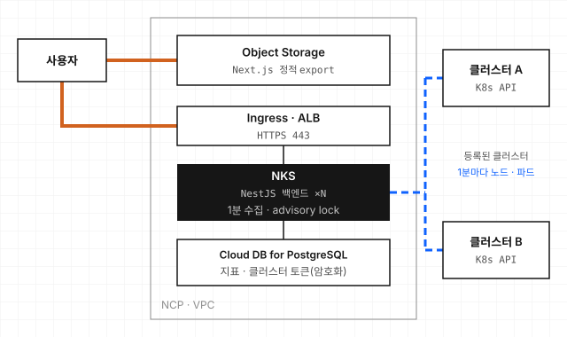

# k8s-multi-cloud-monitor

여러 클라우드에 흩어진 쿠버네티스 클러스터를 등록해 두면, 노드와 파드 상태, CPU와 메모리 사용률을 한 화면에서 보여 주는 웹 앱입니다. 앱(NestJS, Next.js)과 그 앱이 돌아갈 네이버 클라우드(NCP) 인프라(Terraform, NKS)를 혼자 만들었습니다. (2025.10)

프로젝트 소개: <https://woosupar.dev/projects/k8s-multi-cloud-monitor/>

## 구조



- **수집:** 백엔드가 1분마다 등록된 모든 클러스터에서 노드와 파드 정보를 읽어 DB에 쌓습니다. 한 클러스터가 실패해도 나머지는 계속 수집합니다.
- **중복 수집 방지:** 백엔드 파드가 여러 개 떠도 수집은 한 번만 돕니다. 수집을 시작할 때 PostgreSQL advisory lock을 잡고, 못 잡은 파드는 그 회차를 건너뜁니다.
- **토큰 보관:** 클러스터 접근 토큰은 AES-256-GCM으로 암호화해 저장하고, 일반 조회 결과에는 나오지 않게 했습니다.

| 디렉터리 | 내용 |
|---|---|
| `backend/` | NestJS API, 1분 수집 작업, JWT 로그인, 쿠버네티스 매니페스트 |
| `frontend/` | Next.js 대시보드 (정적 export) |
| `infra/` | Terraform: VPC와 서브넷, NAT, NKS 클러스터와 노드 풀, Cloud DB for PostgreSQL |
| `.github/workflows/` | `develop` push 시 바뀐 쪽만 배포 (백엔드는 이미지 빌드 후 `kubectl apply`, 프론트엔드는 Object Storage 동기화) |

## 써 보려면

PostgreSQL이 하나 필요합니다. `NODE_ENV`가 `production`이 아니면 백엔드가 시작할 때 테이블을 자동으로 만듭니다.

```bash
# 백엔드 (기본 포트 3001)
cd backend
npm install
DATABASE_HOST=localhost DATABASE_PORT=5432 DATABASE_NAME=monitor \
DATABASE_USER=monitor DATABASE_PASSWORD=... \
JWT_SECRET=... ENCRYPTION_SECRET_KEY=<32자 이상> \
npm run start:dev

# 프론트엔드
cd frontend
npm install
NEXT_PUBLIC_API_URL=http://localhost:3001 npm run dev
```

사용 순서는 회원 가입, 로그인, 클러스터 등록, 대시보드입니다. 클러스터를 등록할 때는 이름, 프로바이더, 리전, API 엔드포인트, 접근 토큰을 넣습니다.

| API | 설명 |
|---|---|
| `POST /auth/register`, `POST /auth/login` | 가입과 로그인 (JWT) |
| `POST /clusters`, `GET /clusters`, `PUT /clusters/:id`, `DELETE /clusters/:id` | 클러스터 등록과 관리 |
| `GET /k8s/stats`, `GET /k8s/nodes`, `GET /k8s/pods` | 지표와 노드, 파드 조회. `provider`, 기간으로 거름 |

### 알아 둘 것

- **토큰 권한:** 등록하는 토큰은 노드 목록과 모든 네임스페이스의 파드를 읽을 수 있어야 합니다. 읽기 전용 ClusterRole을 붙인 ServiceAccount 토큰을 쓰는 것이 안전합니다.
- **인증서 검증을 하지 않습니다.** 클러스터 API에 붙을 때 TLS 인증서 검증을 끈 상태(`skipTLSVerify`)라, 신뢰할 수 있는 네트워크의 엔드포인트만 등록하세요.
- **사용률 값:** CPU와 메모리 사용률은 0에서 100 사이 값만 그래프에 씁니다. 범위를 벗어난 값은 조회할 때 버립니다.
- **NCP에 다시 구축할 때:** Terraform 밖에서 콘솔로 한 작업이 있습니다(DB 접근 ACG, DB 스키마와 권한, Container Registry, Object Storage 정적 호스팅, 인그레스 로드밸런서). 목록은 `infra/todo`에 있습니다.
